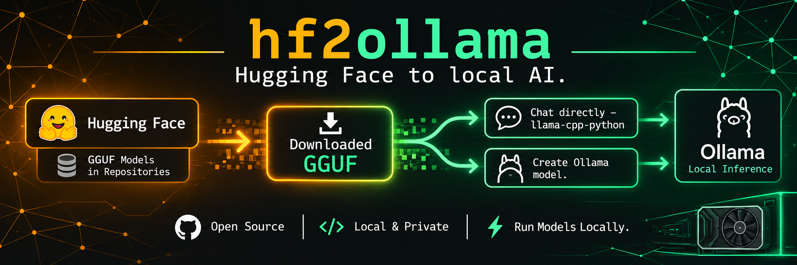

# hf2ollama



Download GGUF models from Hugging Face, chat with them locally through
`llama-cpp-python`, and optionally create Ollama models without writing a
Modelfile manually.

## Features

- Browse and download GGUF files from Hugging Face
- Chat directly with downloaded models
- Switch between local GGUF models
- Create Ollama models with custom instructions and temperature
- Keep inference local and private

## Requirements

- Python 3.9+
- Enough RAM or VRAM for your chosen model
- [Ollama](https://ollama.com/download) only for the Create Ollama Model tab

## Setup

Clone the project first:

[https://github.com/Ronald-PH/hf2ollama.git](https://github.com/Ronald-PH/hf2ollama.git)

```bash
git clone https://github.com/Ronald-PH/hf2ollama.git
cd hf2ollama
```

### Windows

```powershell
python -m venv venv
.\venv\Scripts\Activate.ps1
python -m pip install --upgrade pip
pip install -r requirements.txt
python app.py
```

If `llama-cpp-python` must compile locally, install the Visual Studio C++ Build
Tools. NVIDIA, Vulkan, and CPU-specific builds are available in its
[installation guide](https://github.com/abetlen/llama-cpp-python#installation).

### macOS

```bash
xcode-select --install
python3 -m venv venv
source venv/bin/activate
python -m pip install --upgrade pip
pip install -r requirements.txt
python app.py
```

Apple Silicon uses Metal acceleration when `llama-cpp-python` is installed
with Metal support.

### Linux (Debian/Ubuntu)

```bash
sudo apt update
sudo apt install -y python3 python3-venv build-essential cmake
python3 -m venv venv
source venv/bin/activate
python -m pip install --upgrade pip
pip install -r requirements.txt
python app.py
```

Open <http://localhost:5050>.

## Configuration

| Variable | Default | Purpose |
|---|---:|---|
| `LLAMA_N_CTX` | `4096` | Model context window |
| `LLAMA_N_GPU_LAYERS` | `-1` | Layers offloaded to the GPU; use `0` for CPU |
| `HF_TOKEN` | unset | Access token for gated or private repositories |

Only one GGUF model is kept in memory at a time. Selecting another model
unloads the previous one.
